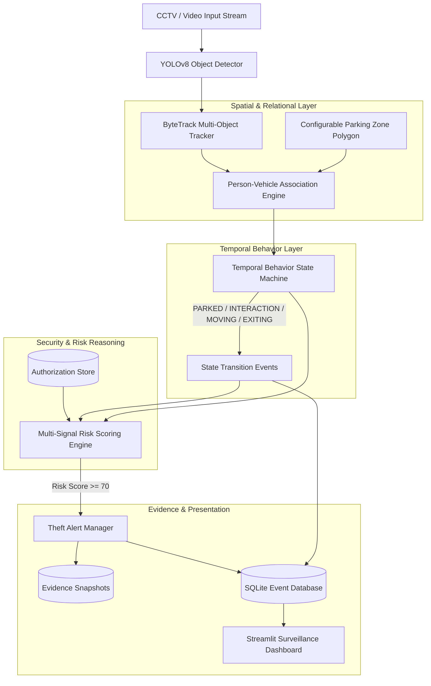

# Contextual Vehicle Theft Detection & Surveillance System

[](https://www.python.org/downloads/)
[](LICENSE)
[](https://streamlit.io/)
[](https://github.com/ultralytics/ultralytics)

A modular, explainable computer vision surveillance system designed to detect, track, associate, and temporally reason about interactions between people and parked vehicles in CCTV footage to estimate vehicle theft risk.

---

## 1. Project Title
**Contextual Vehicle Theft Detection & Surveillance System**  
*Explainable Multi-Signal Risk Reasoning for Smart Parking & CCTV Video Surveillance.*

---

## 2. Problem Statement
Vehicle theft in outdoor parking lots, residential driveways, and commercial garages remains a persistent global challenge. Traditional security setups depend almost entirely on post-incident forensic video review, failing to intervene during the theft event itself. Meanwhile, conventional computer vision solutions rely on crude motion triggers or generic anomaly detectors that generate overwhelming numbers of false alarms for routine activities—such as people walking past cars or owners accessing their trunks. There is an urgent need for an automated system capable of recognizing the structured, multi-step physical sequence characteristic of vehicle theft without prematurely labeling ordinary pedestrians as suspects.

---

## 3. Motivation
Real-world vehicle theft is not an instantaneous anomaly; it unfolds through a logical progression:
1. A person enters a designated parking zone.
2. The person approaches a specific parked vehicle.
3. The person lingers and interacts within the vehicle's immediate perimeter.
4. Physical access attempts occur (e.g. tampering, opening doors, mounting a two-wheeler).
5. The vehicle begins moving without prior authorization.
6. The vehicle exits the monitored parking boundary.

By modeling this temporal behavior sequence, security systems can alert operators to suspicious events in near real-time, prioritize security guards' attention, and record forensic evidence snapshots while avoiding false positives.

---

## 4. Base-Paper Connection
This system builds upon foundational literature in video surveillance and anomalous event detection:
- **Video Anomaly Detection (VAD)**: Concepts from classical and deep surveillance anomaly detection benchmarks (e.g., Sultani et al., *Real-World Anomaly Detection in Surveillance Videos*, CVPR 2018).
- **Multi-Object Tracking (MOT)**: ByteTrack (Zhang et al., *ByteTrack: Multi-Object Tracking by Associating Every Detection Box*, ECCV 2022) for preserving individual trajectory identities across low-confidence bounding boxes.
- **Spatio-Temporal Object Association**: Modeling interactions between human agents and physical objects through proximity, ground-plane projection, and temporal persistence.

---

## 5. Research Gap
> **Research Positioning**:  
> *"Existing video anomaly detection approaches primarily identify anomalous activities in surveillance scenes. This project extends the concept toward vehicle-specific contextual reasoning by associating people with individual parked vehicles and analyzing authorization, temporal interaction, vehicle movement, and exit behavior to estimate vehicle-theft risk."*

Standard surveillance methods suffer from two critical limitations:
1. **Lack of Entity-Level Context**: They classify entire scenes or frame patches as anomalous without associating *which person* is interacting with *which specific vehicle*.
2. **Absence of Explainability & Authorization**: Black-box neural classifiers output confidence scores without explaining *why* an action is suspicious. Furthermore, they lack mechanisms to differentiate authorized vehicle owners from unknown actors.

---

## 6. Proposed Solution
This project implements a multi-stage, rule-transparent computer vision pipeline:
1. **Object Detection**: Fast object detection via YOLOv8 identifying people and vehicles.
2. **Persistent Tracking**: ByteTrack maintaining persistent IDs and trajectory histories across frames.
3. **Parking Zone & Interaction Modeling**: Geofenced parking polygons and vehicle interaction margins.
4. **Relational Association**: Ground-plane distance metrics (person feet to vehicle base) coupled with temporal persistence windows.
5. **Finite State Machine (FSM)**: A temporal behavior engine modeling vehicle state transitions (`PARKED` $\to$ `PERSON_APPROACHING` $\to$ `PERSON_NEAR` $\to$ `INTERACTION` $\to$ `ACCESS_ATTEMPT` $\to$ `VEHICLE_MOVING` $\to$ `EXITING`).
6. **Multi-Signal Risk Engine**: Transparent score accumulation based on authorization status and behavioral signals (0–100).
7. **Surveillance Dashboard & Database**: An interactive Streamlit console backed by local SQLite persistence and automated evidence capture.

---

## 7. System Architecture



---

## 8. Technology Stack

| Layer | Technologies |
|---|---|
| **Deep Learning & Detection** | Ultralytics YOLOv8 (`yolov8n.pt`, PyTorch) |
| **Multi-Object Tracking** | ByteTrack (`lap` Linear Assignment, Kalman filter) |
| **Computer Vision & Drawing** | OpenCV (`opencv-python` 4.8+) |
| **Data Processing & Geometry** | NumPy, PyYAML |
| **Persistence & Audit** | SQLite3 (standard library, zero external overhead) |
| **User Interface & Dashboard** | Streamlit |
| **Testing & Quality Assurance** | Pytest, AnyIO |

---

## 9. Features

- **Multi-Object Tracking with Persistent IDs**: Distinguishes between `Person #1`, `Person #4`, `Motorcycle #2`, and `Car #7` with smooth motion trajectory trails.
- **Configurable Polygonal Parking Zones**: Custom polygons defining monitored parking regions with point-in-polygon containment checks.
- **Ground-Plane Proximity Calculation**: Uses bottom-center bounding box coordinates (feet location) to avoid projection distortion in surveillance cameras.
- **Jitter-Resistant Vehicle Motion Detection**: Displaces bounding box center history over rolling windows (10 frames) to filter out camera sensor noise.
- **Explainable Multi-Signal Risk Model**: Risk scores are 100% transparent and inspectable:
  - Unknown person: $+20$
  - Approaching / near vehicle: $+10$
  - Persistent interaction: $+20$
  - Access attempt detected: $+20$
  - Vehicle moving without authorization: $+30$
  - Exit boundary crossed: $+40$
- **Automated Evidence Snapshots**: Automatically captures and annotates frame images into `data/output/snapshots/` when high risk is triggered.
- **Local SQLite Audit Trail**: Stores all behavior transitions and alerts in `data/output/surveillance.db`.
- **Interactive Web Dashboard**: Streamlit interface featuring live video streams, KPI status indicators, relationship cards, alert galleries, and queryable event history.

---

## 10. Installation

### Prerequisites
- Python 3.11 or higher
- Git
- Recommended: Dedicated virtual environment

### Step-by-Step Setup

```bash
# 1. Clone repository
git clone https://github.com/your-username/vehicle-theft-detection.git
cd vehicle-theft-detection

# 2. Create and activate virtual environment
python -m venv .venv

# On Windows:
.venv\Scripts\activate
# On Linux/macOS:
# source .venv/bin/activate

# 3. Upgrade pip and install dependencies
pip install --upgrade pip
pip install -r requirements.txt
```

---

## 11. How to Run

### Option 1: Launch the Interactive Surveillance Dashboard (Recommended)

```bash
# Using the launcher script:
python scripts/run_dashboard.py

# Or directly via Streamlit:
streamlit run app/dashboard.py
```
Open your web browser at `http://localhost:8501`.

### Option 2: Run End-to-End Risk Analysis via CLI

```bash
python scripts/run_risk_analysis.py \
    --input data/input/test.mp4 \
    --output data/output/risk_analyzed.mp4 \
    --alerts data/output/alerts.json \
    --events data/output/events.json
```

### Option 3: Run Individual Modular Phases

```bash
# Phase 1: Pure Detection
python scripts/run_detection.py --input data/input/test.mp4 --save

# Phase 2: ByteTrack Tracking
python scripts/run_tracking.py --input data/input/test.mp4 --save

# Phase 3: Person-Vehicle Association
python scripts/run_association.py --input data/input/test.mp4 --save

# Phase 4: Temporal Behavior State Machine
python scripts/run_behavior.py --input data/input/test.mp4 --save
```

---

## 12. Configuration

System parameters can be adjusted via YAML files in the `configs/` directory or `.env` variables:

### 1. Parking Zone Configuration (`configs/parking_zone.yaml`)
```yaml
parking_zone:
  points:
    - [50, 50]
    - [1200, 50]
    - [1200, 700]
    - [50, 700]
```

### 2. Temporal Behavior Parameters (`configs/behavior.yaml`)
```yaml
behavior:
  movement_threshold_px: 18.0
  movement_window_frames: 10
  movement_consecutive_frames: 4
  approaching_distance_px: 250.0
  near_distance_px: 120.0
  interaction_duration_sec: 1.0
  access_attempt_duration_sec: 2.5
```

### 3. Authorization & Scoring Weights (`configs/authorization.yaml`)
```yaml
authorization:
  vehicles:
    "1":
      authorized_persons:
        - 1
        - 2

risk_weights:
  unknown_person: 20
  approach: 10
  persistent_interaction: 20
  access_attempt: 20
  vehicle_movement: 30
  exit_crossing: 40

risk_thresholds:
  medium: 40
  high: 70
```

---

## 13. Sample Workflow

1. **Video Ingestion**: The system ingests CCTV video (`810x1080` @ 25 FPS).
2. **Detections**: YOLOv8n detects `Motorcycle #1` (stationary) and `Person #4` entering the frame.
3. **Association**: `Person #4` walks toward `Motorcycle #1`. At distance $< 120\text{ px}$, association transitions from `CANDIDATE` to `PERSISTENT`.
4. **Behavior State**: Vehicle state shifts from `PARKED` $\to$ `PERSON_APPROACHING` $\to$ `PERSON_NEAR` $\to$ `INTERACTION`.
5. **Access Attempt**: After lingering for $> 2.5\text{ seconds}$, the state machine enters `ACCESS_ATTEMPT`.
6. **Risk Calculation**:
   - Unknown person: $+20$
   - Approaching/near: $+10$
   - Interaction: $+20$
   - Access attempt: $+20$
   - **Total Risk Score**: $70$ ($\ge 70 \implies \text{HIGH RISK}$).
7. **Alert Triggered**:
   - Alert logged: `[ALERT: POTENTIAL VEHICLE THEFT]` on `Vehicle #1`.
   - Evidence snapshot captured: `data/output/snapshots/alert_v1_p4_3000.jpg`.
   - Event and alert persisted to SQLite `surveillance.db`.
   - Dashboard instantly displays the high-risk alert card with visual snapshot.

---

## 14. Performance & Hardware Benchmarks

| Metric | Measured Value | Notes |
|---|---|---|
| **Model** | YOLOv8n (`yolov8n.pt`) | 3.2M parameters |
| **Input Resolution** | $810 \times 1080$ px | Portrait CCTV video |
| **Execution Hardware** | Standard x86_64 CPU (Windows) | No GPU acceleration |
| **Pipeline Speed** | **$11.3 - 12.0$ FPS** | End-to-end (Detection + Tracking + Association + Behavior + Drawing) |
| **Real-Time Feasibility** | **Near Real-Time on CPU** | At standard 25–30 FPS camera feeds, CPU processing achieves $\sim 0.4\times$ real-time. Full real-time ($30+$ FPS) is achieved either by setting frame stride to 2 or by enabling GPU acceleration (`device: cuda`). |

> *Note: We report genuine measured benchmarks. Unrealistic claims of 60+ FPS on CPU without hardware acceleration are avoided.*

---

## 15. Limitations

1. **Occlusion & Crowded Scenes**: Severe visual occlusion (e.g. dense crowds walking between camera and vehicle) can disrupt ByteTrack ID continuity.
2. **Camera Perspective**: Distances are currently computed in 2D image pixel space. Accurate metric distance estimation requires camera calibration and perspective homography transformation.
3. **Identity Stability**: In raw CCTV streams, tracking IDs reset across recording sessions. True long-term identity persistence requires biometric or Person Re-Identification (Re-ID) embedding matching.
4. **Lighting & Night Footage**: Standard YOLO models trained on daytime COCO datasets suffer degraded accuracy in low-light night-time surveillance.

---

## 16. Future Improvements

- **Homography Ground-Plane Projection**: Calibrating camera perspective to measure real-world distances in meters.
- **Deep Person Re-Identification (Re-ID)**: Integrating lightweight feature embedding extractors (e.g. OSNet) to maintain person identities across non-overlapping surveillance cameras.
- **Pose Estimation for Tampering Verification**: Employing YOLOv8-pose to verify specific tampering postures (e.g., crouching near ignition, forced lock manipulation).
- **Edge Deployment Optimization**: Exporting model weights to TensorRT or ONNX Runtime for $30+$ FPS inference on NVIDIA Jetson edge surveillance appliances.

---

## 17. Ethical & Privacy Considerations

- **No Criminal Classification**: **The system does NOT declare any human to be a "criminal" or "thief".** It strictly flags **`POTENTIAL VEHICLE THEFT`** and **`SUSPICIOUS ACTIVITY`** based on observable physical interactions and authorization rules.
- **Human-in-the-Loop Requirement**: The system is designed strictly as a decision-support tool for human security operators. No automated physical enforcement or punitive action should ever occur without human verification.
- **Privacy Compliance**: Surveillance footage should adhere to regional data privacy laws (e.g. GDPR). In production environments, face-blurring filters should be applied to bystanders not associated with security incidents.

---

## 18. Testing & Verification

The project includes an automated test suite covering all modules:

```bash
# Run the entire test suite
pytest -v
```

### Test Coverage Summary:
- **`test_detector.py`**: Model loading, target class filtering, coordinate normalization.
- **`test_tracker.py`**: TrackedObject data model, ID preservation, trail histories.
- **`test_association.py`**: Center and feet distance calculations, temporal persistence.
- **`test_behavior.py`**: State machine transitions, jitter displacement filtering, event serialization.
- **`test_risk_engine.py`**: Authorization matching, cumulative score evaluation, cooldowns, snapshots.
- **`test_database.py`**: SQLite table creation, event logging, score querying, security aggregation.
- **`test_stream_pipeline.py`**: Streaming generator outputs, frame shapes, max frame limits.

**Result**: `46 passed in 5.12s` (100% pass rate).

---

## 19. Project Structure

```
vehicle-theft-detection/
├── app/
│   ├── __init__.py
│   ├── association.py       # Spatio-temporal person-vehicle association
│   ├── authorization.py     # Authorization lookup store
│   ├── behavior.py          # Temporal Finite State Machine (FSM)
│   ├── config.py            # Central configuration & dataclasses
│   ├── dashboard.py         # Streamlit surveillance web dashboard
│   ├── database.py          # SQLite database audit logger
│   ├── detector.py          # YOLOv8 object detection wrapper
│   ├── risk_engine.py       # Multi-signal theft risk scoring & alerts
│   ├── tracker.py           # ByteTrack multi-object tracker
│   ├── video_processor.py   # Integrated multi-phase video processor
│   └── zone.py              # Parking zone polygon & geometry utilities
│
├── configs/
│   ├── authorization.yaml   # Vehicle-to-person authorization rules
│   ├── behavior.yaml        # FSM state thresholds and timings
│   └── parking_zone.yaml    # Configurable parking polygon coordinates
│
├── data/
│   ├── input/               # Surveillance video footage (.gitkeep)
│   └── output/              # Annotated videos, JSON logs, snapshots (.gitkeep)
│       └── snapshots/       # Captured evidence images (.gitkeep)
│
├── models/                  # Local model weights directory
├── scripts/
│   ├── run_detection.py     # Phase 1 CLI runner
│   ├── run_tracking.py      # Phase 2 CLI runner
│   ├── run_association.py   # Phase 3 CLI runner
│   ├── run_behavior.py      # Phase 4 CLI runner
│   ├── run_risk_analysis.py # Phase 5 CLI runner
│   └── run_dashboard.py     # Phase 6 Streamlit dashboard launcher
│
├── tests/
│   ├── test_association.py
│   ├── test_behavior.py
│   ├── test_database.py
│   ├── test_detector.py
│   ├── test_risk_engine.py
│   ├── test_stream_pipeline.py
│   └── test_tracker.py
│
├── .gitignore               # Excludes virtual environments, DBs, models, and media
├── README.md                # Comprehensive project documentation
└── requirements.txt         # Production dependencies
```
